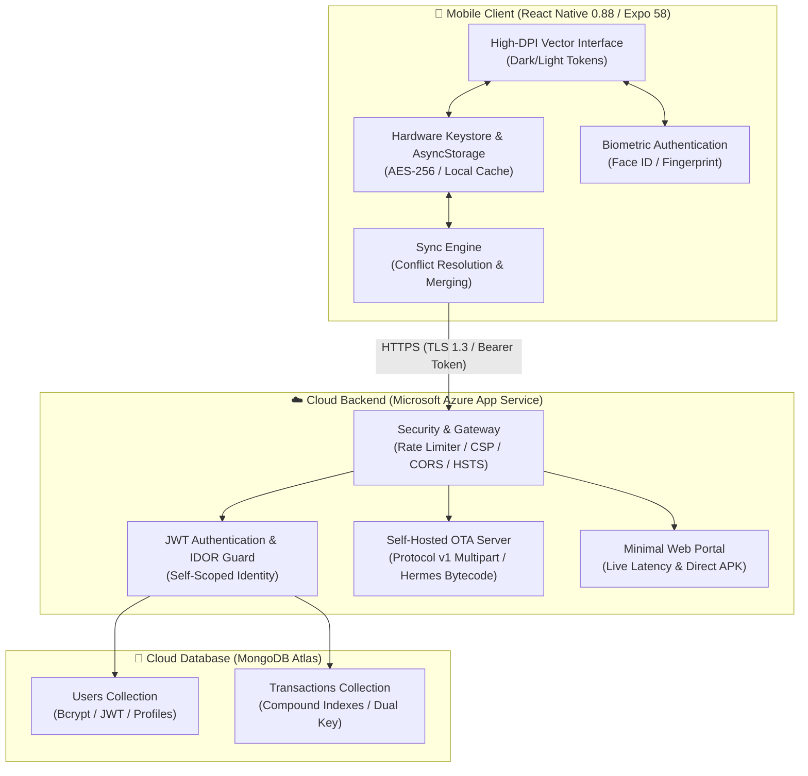

# Suwan's FundManager

<div align="center">
  
  <h2 style="margin-top: 14px; margin-bottom: 6px;">Suwan's FundManager</h2>
  <p><strong>Offline-First Personal Finance Tracker with MongoDB Atlas Cloud Sync & Azure OTA Updates</strong></p>

  <p>
    <a href="https://fundmanager-api-aphxbabxdvd2g5a0.uaenorth-01.azurewebsites.net/download/apk"></a>
    <a href="https://fundmanager-api-aphxbabxdvd2g5a0.uaenorth-01.azurewebsites.net"></a>
    <a href="https://github.com/suwandhital/fundmanager/releases/latest"></a>
    
    
    
  </p>
</div>

---

## Overview

**Suwan's FundManager** is a high-performance personal money and wealth manager designed for mobile speed, visual clarity, and data independence. 

Built with **React Native 0.88** and **Expo SDK 58**, it pairs an instant **100% offline-first local cache** with an automated **two-way MongoDB Atlas cloud synchronization** engine and self-hosted **Over-The-Air (OTA) updates** distributed directly from **Microsoft Azure App Service**.

```
📱 Client (iOS & Android)  ◄─── HTTPS / WSS ───►  ☁️ Microsoft Azure App Service  ◄─── TLS ───►  🍃 MongoDB Atlas
  • Hermes Bytecode Engine                          • Express 5 Secure REST API                      • Encrypted Clusters
  • Biometric Keystore (0ms)                        • Self-Hosted OTA Protocol v1                    • User & Tx Collections
  • 4K Supersampled UI                              • Sliding-Window Rate Limiting                   • Compound Indexes
```

---

## System Architecture



## Project Structure

```
fundmanager/
├── .github/
│   └── workflows/
│       ├── build-apk.yml               # Automated Android standalone APK compiler
│       └── main_fundmanager-api.yml     # Automated Azure App Service CI/CD deployer
├── assets/                             # 4x Supersampled vector brand assets (4096 -> 1024)
│   ├── icon.png                        # App launcher icon
│   ├── splash-icon.png                 # Centered transparent Android 12+ splash emblem
│   ├── android-icon-foreground.png     # Adaptive icon foreground (66% safe mask)
│   ├── android-icon-background.png     # Deep navy adaptive icon background (#090d16)
│   ├── android-icon-monochrome.png     # Android 13+ monochrome icon
│   └── favicon.png                     # Web browser favicon
├── server/                             # Cloud backend service
│   ├── index.js                        # Hardened Express 5 server & OTA Protocol v1 engine
│   ├── package.json                    # Backend dependencies (mongoose, bcryptjs, jwt, form-data)
│   ├── public/                         # Minimal clean white portal & APK distribution
│   │   └── index.html                  # Minimal responsive landing page
│   └── updates/                        # Exported Over-The-Air Hermes bytecode bundles
├── src/                                # Mobile client source code
│   ├── components/                     # Reusable UI components
│   │   ├── BalanceCard.tsx             # Total balance & metric overview cards
│   │   ├── FilterBar.tsx               # Instant search & type filter chips
│   │   ├── Header.tsx                  # Profile, theme switch, and sync status
│   │   ├── LineChart.tsx               # High-performance SVG line & area charts
│   │   ├── ProfileSheet.tsx            # Profile edit, OTA updater & biometric toggle
│   │   ├── TransactionList.tsx         # FlatList with date grouping & unsynced indicators
│   │   ├── TransactionSheet.tsx        # Keyboard-avoiding CRUD modal
│   │   └── layout/MobileFrame.tsx      # Cross-platform responsive viewport
│   ├── context/                        # Global state providers
│   │   ├── AuthContext.tsx             # Authentication, biometrics & cloud API config
│   │   ├── ToastContext.tsx            # Floating toast notification system
│   │   └── TransactionContext.tsx      # Financial state, two-way sync & calculations
│   ├── theme/                          # Design tokens & color system
│   │   ├── colors.ts                   # Hex color tokens (light & dark palettes)
│   │   └── ThemeContext.tsx            # Persistent theme provider
│   ├── types/                          # TypeScript definitions
│   │   └── index.ts                    # Core interfaces & types
│   └── utils/                          # Pure utility functions
│       ├── crypto.ts                   # UUID generation & password hashing
│       ├── formatters.ts               # Currency (NRS), locale (en-IN), dates & times
│       └── sampleData.ts               # Sample transaction seeder
├── App.tsx                             # Application entry with splash coordination
├── app.json                            # Expo SDK 58 application manifest & native config
├── eas.json                            # EAS build configuration
└── package.json                        # Client dependencies
```

---

## Troubleshooting & FAQ

<details>
<summary><strong>How do I install the APK on an Android device?</strong></summary>

1. Download `FundManager.apk` from the [Download Link](https://fundmanager-api-aphxbabxdvd2g5a0.uaenorth-01.azurewebsites.net/download/apk).
2. Tap the downloaded file in your browser or file manager.
3. If prompted with *"For your security, your phone is not allowed to install unknown apps"*, tap **Settings** and toggle **Allow from this source**.
4. Tap **Install** and launch the app.
</details>

<details>
<summary><strong>Does biometric login require an internet connection?</strong></summary>

No. Biometric unlock runs **100% offline** via device-native hardware sensors (`expo-local-authentication`). The session token is retrieved directly from the device's hardware-backed Keystore / Keychain.
</details>

<details>
<summary><strong>What happens if I record transactions while offline?</strong></summary>

All transactions are saved immediately to local storage. When you reconnect to the internet and tap the **Sync** button in the header, the app performs a two-way merge with MongoDB Atlas Cloud with conflict resolution based on transaction timestamps.
</details>

---

## License

This project is licensed under the [MIT License](LICENSE).
