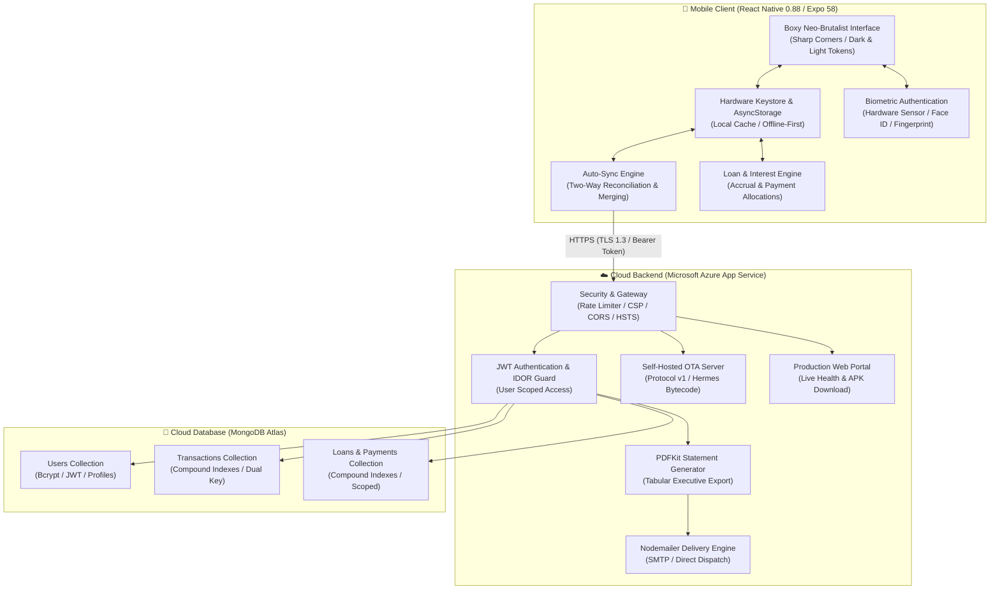

# Suwan's FundManager

<div align="center">
  
  <h2 style="margin-top: 14px; margin-bottom: 6px;">Suwan's FundManager</h2>
  <p><strong>Executive Offline-First Personal Finance Tracker, Debt & Loan Manager, Wealth Analytics & Cloud Sync</strong></p>

  <p>
    <a href="https://fundmanager-api-aphxbabxdvd2g5a0.uaenorth-01.azurewebsites.net/download/apk"></a>
    <a href="https://fundmanager-api-aphxbabxdvd2g5a0.uaenorth-01.azurewebsites.net"></a>
    <a href="https://github.com/suwandhital/fundmanager/releases/latest"></a>
    
    
    
    
  </p>
</div>

---

## Overview

**Suwan's FundManager** is a high-performance personal money, debt, and wealth manager designed for mobile speed, visual clarity, data sovereignty, and peace of mind. 

Built with **React Native 0.88** and **Expo SDK 58**, it pairs an instant **100% offline-first local cache** with an automated **two-way MongoDB Atlas cloud synchronization** engine, executive **PDF statement delivery to email**, real-time **loan/interest lifecycle calculations**, and self-hosted **Over-The-Air (OTA) updates** distributed directly from **Microsoft Azure App Service**.

```
📱 Client (iOS & Android)  ◄─── HTTPS / WSS ───►  ☁️ Microsoft Azure App Service  ◄─── TLS ───►  🍃 MongoDB Atlas
  • Hermes Bytecode Engine                          • Express 5 Secure REST API                      • Encrypted Clusters
  • Biometric Keystore (0ms)                        • Self-Hosted OTA Protocol v1                    • User, Tx & Loan Collections
  • Boxy Neo-Brutalist UI                           • PDFKit Statement Generation                    • Compound Indexes
  • Local-First SQLite/AsyncStorage                 • Nodemailer SMTP Delivery                       • Dual Key Scoping
```

---

## Core Capabilities

1. **Neo-Brutalist Boxy Design System**
   - High-contrast, sharp 90-degree corners (`borderRadius: 0`) across all cards, modals, buttons, chips, and inputs.
   - Clean, functional dark/light mode color tokens with immediate toggle.
   - Pure English terminology throughout the application for international clarity.

2. **Unified 4-Section Architecture**
   - **Transactions**: Daily cash flows, income & expense categorization, date drag-and-drop filters, search, and dynamic balance calculations.
   - **To Pay (Debts Borrowed)**: Track personal loans, borrowed debts, accrued interest, and child payment logs (principal vs interest).
   - **To Receive (Loans Given)**: Track receivables, money lent out, interest gain calculations, and partial/full settlement schedules.
   - **Deep Analysis & Wealth Advisory**: Financial health scoring, month-over-month cash flow dynamics, top spend category breakdown, biggest single expenditures, and actionable wealth directives.

3. **Executive PDF Financial Statement Delivery**
   - Generate high-fidelity executive tabular PDF reports of your transactions directly from the app.
   - Preserves all active filters (date ranges, income/expense types, and keyword search).
   - Delivered immediately to the user's verified email address via the cloud backend.

4. **Offline-First & Seamless Cloud Synchronization**
   - 100% functional without network connectivity.
   - Auto-syncs silently whenever an active network connection is detected.
   - Biometric authentication (Fingerprint / Face ID) automatically keeps cloud sessions active.

5. **Self-Hosted Azure OTA Updates**
   - Daily automatic background update checks upon application startup.
   - Instant delta updates via Hermes Bytecode bundles deployed directly from Azure App Service.

---

## System Architecture



---

## Project Structure

```
fundmanager/
├── .github/
│   └── workflows/
│       ├── build-apk.yml               # Automated Android standalone APK compiler
│       └── main_fundmanager-api.yml     # Automated Azure App Service CI/CD deployer
├── assets/                             # Vector brand assets & launcher icons
│   ├── icon.png                        # App launcher icon
│   ├── splash-icon.png                 # Centered splash screen emblem
│   ├── android-icon-foreground.png     # Adaptive icon foreground
│   ├── android-icon-background.png     # Adaptive icon background
│   ├── android-icon-monochrome.png     # Android 13+ monochrome icon
│   └── favicon.png                     # Web browser favicon
├── server/                             # Cloud backend service
│   ├── index.js                        # Hardened Express 5 server & OTA Protocol v1 engine
│   ├── pdfGenerator.js                 # Executive PDF tabular financial statement generator
│   ├── package.json                    # Backend dependencies (mongoose, nodemailer, pdfkit, etc.)
│   ├── .env.example                    # Backend environment template
│   ├── public/                         # Minimal clean portal & APK distribution
│   │   ├── index.html                  # Responsive portal landing page
│   │   └── favicon.svg                 # Web favicon
│   └── updates/                        # Exported Over-The-Air Hermes bytecode bundles
│       └── 1.0.0/                      # Version 1.0.0 production update bundle
├── src/                                # Mobile client source code
│   ├── components/                     # Reusable UI components (Boxy Neo-Brutalist)
│   │   ├── AnalysisView.tsx            # Financial health score, category ranking & insights
│   │   ├── BalanceCard.tsx             # Total balance & metric overview cards
│   │   ├── FilterBar.tsx               # Instant search, type filter chips & date badges
│   │   ├── Header.tsx                  # Profile, theme switch, auto-sync indicator
│   │   ├── LineChart.tsx               # High-performance SVG line & area charts
│   │   ├── LoanDetailSheet.tsx         # Loan breakdown, payment logger & settlement history
│   │   ├── LoanList.tsx                # To Pay / To Receive lists with progress bars
│   │   ├── LoanSheet.tsx               # Modal to create/edit debt or loan records
│   │   ├── LoanSummaryCard.tsx         # Outstanding principal & accrued interest summary
│   │   ├── ProfileSheet.tsx            # Profile edit, OTA updater & biometric toggle
│   │   ├── TransactionList.tsx         # FlatList with date grouping & email export modal
│   │   ├── TransactionSheet.tsx        # Keyboard-avoiding CRUD modal
│   │   └── layout/MobileFrame.tsx      # Cross-platform responsive viewport
│   ├── context/                        # Global state providers
│   │   ├── AuthContext.tsx             # Authentication, biometrics & cloud API config
│   │   ├── LoanContext.tsx             # Loan & debt lifecycle state & auto-sync
│   │   ├── ToastContext.tsx            # Floating toast notification system
│   │   └── TransactionContext.tsx      # Financial state, two-way sync & calculations
│   ├── screens/
│   │   ├── AuthScreen.tsx              # Login & registration screen
│   │   └── MainScreen.tsx              # Main dashboard with 4-tab switcher
│   ├── theme/                          # Design tokens & color system
│   │   ├── colors.ts                   # Hex color tokens (light & dark palettes)
│   │   └── ThemeContext.tsx            # Persistent theme provider
│   ├── types/                          # TypeScript definitions
│   │   └── index.ts                    # Core interfaces & types
│   └── utils/                          # Pure utility functions
│       ├── crypto.ts                   # UUID generation & password hashing
│       ├── formatters.ts               # Currency (NRS), locale (en-IN), dates & times
│       ├── loanCalculations.ts         # Accrued interest, payoff timelines & summaries
│       └── sampleData.ts               # Sample transaction seeder
├── App.tsx                             # Application entry with splash coordination
├── app.json                            # Expo SDK 58 application manifest & native config
├── eas.json                            # EAS build configuration
└── package.json                        # Client dependencies
```

---

## Quality Assurance & Verification

Every build and release is rigorously tested against strict quality standards:

```bash
# 1. Typecheck TypeScript across all components and contexts
npx tsc --noEmit

# 2. Lint using Expo ESLint configuration
npx expo lint

# 3. Expo SDK dependency and environment validation
npx expo-doctor

# 4. Node.js backend syntax and security check
node -c server/index.js && node -c server/pdfGenerator.js
```

---

## Frequently Asked Questions

<details>
<summary><strong>How do I install the APK on an Android device?</strong></summary>

1. Download `FundManager.apk` from the [Download Link](https://fundmanager-api-aphxbabxdvd2g5a0.uaenorth-01.azurewebsites.net/download/apk).
2. Tap the downloaded file in your browser or file manager.
3. If prompted with *"For your security, your phone is not allowed to install unknown apps"*, tap **Settings** and toggle **Allow from this source**.
4. Tap **Install** and launch the app.
</details>

<details>
<summary><strong>How does Over-The-Air (OTA) updates work?</strong></summary>

The app automatically checks the Azure OTA endpoint daily upon application start. When an update bundle is detected, it is silently downloaded in the background and seamlessly applied on the next cold restart without requiring manual APK reinstallation.
</details>

<details>
<summary><strong>Is my financial data isolated and secure?</strong></summary>

Yes. All transactions and loans stored locally are retained on your physical device. In the cloud backend, every database record is isolated by strict user ID and email scoping with JWT authorization and Insecure Direct Object Reference (IDOR) prevention guards.
</details>

<details>
<summary><strong>How do I export my financial records to email?</strong></summary>

In the Transactions tab, tap the **Export PDF** button. You can review your active filters (e.g. date range or search query) and enter your email address. The backend compiles a clean, executive tabular PDF statement and delivers it directly to your inbox.
</details>

---

## License

This project is licensed under the [MIT License](LICENSE).
