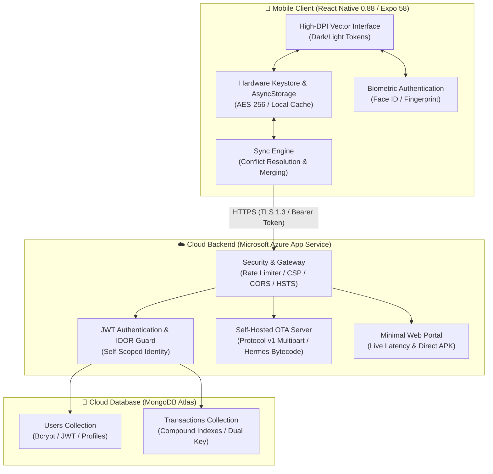

# Suwan's FundManager

<div align="center">
  
  <h2 style="margin-top: 14px; margin-bottom: 6px;">Suwan's FundManager</h2>
  <p><strong>Offline-First Personal Finance Tracker with MongoDB Atlas Cloud Sync & Azure OTA Updates</strong></p>

  <p>
    <a href="https://fundmanager-api-aphxbabxdvd2g5a0.uaenorth-01.azurewebsites.net/download/apk"></a>
    <a href="https://fundmanager-api-aphxbabxdvd2g5a0.uaenorth-01.azurewebsites.net"></a>
    <a href="https://github.com/suwandhital/fundmanager/releases/latest"></a>
    
    
    
  </p>
</div>

---

## Table of Contents

- [Overview](#overview)
- [System Architecture](#system-architecture)
- [Key Features](#key-features)
- [Security Architecture](#security-architecture)
- [Production Endpoints](#production-endpoints)
- [Project Structure](#project-structure)
- [Local Development](#local-development)
- [Build & Deployment](#build--deployment)
- [Troubleshooting & FAQ](#troubleshooting--faq)
- [License](#license)

---

## Overview

**Suwan's FundManager** is a high-performance personal money and wealth manager designed for mobile speed, visual clarity, and data independence. 

Built with **React Native 0.88** and **Expo SDK 58**, it pairs an instant **100% offline-first local cache** with an automated **two-way MongoDB Atlas cloud synchronization** engine and self-hosted **Over-The-Air (OTA) updates** distributed directly from **Microsoft Azure App Service**.

```
📱 Client (iOS & Android)  ◄─── HTTPS / WSS ───►  ☁️ Microsoft Azure App Service  ◄─── TLS ───►  🍃 MongoDB Atlas
  • Hermes Bytecode Engine                          • Express 5 Secure REST API                      • Encrypted Clusters
  • Biometric Keystore (0ms)                        • Self-Hosted OTA Protocol v1                    • User & Tx Collections
  • 4K Supersampled UI                              • Sliding-Window Rate Limiting                   • Compound Indexes
```

---

## System Architecture



---

## Key Features

### 1. Offline-First & Zero-Glitter Launch
- **Instant Cold Start**: Local database queries resolve in `<10ms` using `@react-native-async-storage/async-storage`.
- **Zero-Flicker Splash Coordination**: The native splash screen waits until theme tokens, authentication state, and cached transaction data are fully rasterized, preventing visual jumps or flashing zero-balances on startup.
- **Dynamic Theming**: Full Dark (`#090d16`) and Light color token systems with automatic status bar synchronization.

### 2. High-Precision Financial Analytics
- **Dual Metric Balance Card**: Real-time balance computation in Nepali Rupees (`NRS `) using Indian numbering system formatting (`en-IN`), complete with period indicators (`Today`, `This week`, `This month`, `This year`).
- **Interactive SVG Charting**: Renders dual area & line graphs across `Day` (24 hourly buckets), `Week` (Mon–Sun), `Month` (weekly intervals), and `Year` (12 months).
- **Chart Scrubbing**: Touch and drag across chart segments to instantly filter transactions by date range.

### 3. Smart Transaction Management
- **Color-Shifting CRUD Modal**: Adapts handles, badges, and input accents dynamically (Emerald `#22c55e` for Income, Crimson `#ef4444` for Expense).
- **Keyboard-Adaptive Layout**: Built with `KeyboardAvoidingView` so input sheets dynamically shift above soft keyboards.
- **Quick Filters**: Instant text search across notes, categories, formatted amounts, and dates, with `In` / `Out` type chips.

### 4. Self-Hosted Continuous Updates (OTA)
- **Zero-Token Distribution**: Distributes compiled Hermes bytecode updates directly to client devices via a custom Expo Updates Protocol v1 implementation (`multipart/mixed; boundary=...`) running on Azure App Service.
- **Background Checks**: Checks for updates on load and via the in-app Profile Settings screen.

---

## Security Architecture

The application implements defense-in-depth security across every tier:

| Security Domain | Implementation | Protection Mechanism |
| :--- | :--- | :--- |
| **Insecure Direct Object Reference (IDOR)** | Verified JWT User Scoping | Every database query and sync upsert strictly enforces `req.user.id` and `req.user.email` from verified JWT payloads. Users cannot access or mutate another user's financial records. |
| **Brute-Force & Credential Stuffing** | In-Memory Sliding-Window Limiter | Auth endpoints (`/api/auth/*`) are restricted to **15 attempts per 15 minutes** per IP. Returns `429 Too Many Requests` with standard `Retry-After` headers. |
| **API Denial of Service (DoS)** | Request Limiting & Payload Clamping | General API calls are capped at **120 requests/minute**. Body parser is clamped to `500kb` (`express.json({ limit: '500kb' })`) and sync batches to **500 items**. |
| **NoSQL & Parameter Injection** | Strict Type Sanitization | Custom sanitizer strips null bytes and control characters, coercing all inputs to strict primitives to neutralize Mongo query selectors (`$gt`, `$ne`). |
| **Account Enumeration / Timing Attacks** | Constant-Time Hash Simulation | When a login attempt targets a nonexistent email, the server runs a dummy bcrypt comparison so response latency is identical for existing and non-existing accounts. |
| **Biometric Keystore Persistence** | Hardware-Backed SecureStore | Biometric keys and session JWTs are encrypted on-device via iOS Keychain and Android Keystore (AES-256-GCM). |
| **Path Traversal Defense** | Normalized Directory Sandboxing | OTA asset requests verify that `path.resolve` stays strictly within the designated update directory, blocking `../` traversal attempts. |
| **HTTP Hardening** | Security Headers & Information Masking | Enforces `HSTS`, `CSP`, `X-Frame-Options: DENY`, `X-Content-Type-Options: nosniff`, and strips `X-Powered-By`. |

---

## Production Endpoints

The backend API is deployed on **Microsoft Azure App Service** (Linux / Node.js 22):

```
Base URL: https://fundmanager-api-aphxbabxdvd2g5a0.uaenorth-01.azurewebsites.net
```

| Path | Method | Auth | Description |
| :--- | :---: | :---: | :--- |
| `/` | `GET` | Public | Minimal web portal with live latency monitor & direct APK link |
| `/download/apk` | `GET` | Public | Direct standalone Android APK download |
| `/api/health` | `GET` | Public | Service health verification and ISO timestamp |
| `/api/version` | `GET` | Public | Application version metadata and release URLs |
| `/api/auth/register` | `POST` | Public (Rate-Limited) | Register new user account into MongoDB Atlas |
| `/api/auth/login` | `POST` | Public (Rate-Limited) | Authenticate user & issue 60-day JWT token |
| `/api/auth/profile` | `PUT / POST` | Bearer JWT | Update user display name, email, or password |
| `/api/transactions` | `GET` | Bearer JWT | Retrieve user transactions (scoped to authenticated identity) |
| `/api/transactions/:txId` | `DELETE` | Bearer JWT | Delete single transaction belonging to authenticated user |
| `/api/sync` | `POST` | Bearer JWT | Batch upsert and sync transactions (two-way merge) |
| `/api/manifest` | `GET` | Public | Expo Updates Protocol v1 multipart manifest server |
| `/api/assets` | `GET` | Public | Distribute Hermes bytecode bundles and vector assets |

---

## Project Structure

```
fundmanager/
├── .github/
│   └── workflows/
│       ├── build-apk.yml               # Automated Android standalone APK compiler
│       └── main_fundmanager-api.yml     # Automated Azure App Service CI/CD deployer
├── assets/                             # 4x Supersampled vector brand assets (4096 -> 1024)
│   ├── icon.png                        # App launcher icon
│   ├── splash-icon.png                 # Centered transparent Android 12+ splash emblem
│   ├── android-icon-foreground.png     # Adaptive icon foreground (66% safe mask)
│   ├── android-icon-background.png     # Deep navy adaptive icon background (#090d16)
│   ├── android-icon-monochrome.png     # Android 13+ monochrome icon
│   └── favicon.png                     # Web browser favicon
├── server/                             # Cloud backend service
│   ├── index.js                        # Hardened Express 5 server & OTA Protocol v1 engine
│   ├── package.json                    # Backend dependencies (mongoose, bcryptjs, jwt, form-data)
│   ├── public/                         # Minimal clean white portal & APK distribution
│   │   └── index.html                  # Minimal responsive landing page
│   └── updates/                        # Exported Over-The-Air Hermes bytecode bundles
├── src/                                # Mobile client source code
│   ├── components/                     # Reusable UI components
│   │   ├── BalanceCard.tsx             # Total balance & metric overview cards
│   │   ├── FilterBar.tsx               # Instant search & type filter chips
│   │   ├── Header.tsx                  # Profile, theme switch, and sync status
│   │   ├── LineChart.tsx               # High-performance SVG line & area charts
│   │   ├── ProfileSheet.tsx            # Profile edit, OTA updater & biometric toggle
│   │   ├── TransactionList.tsx         # FlatList with date grouping & unsynced indicators
│   │   ├── TransactionSheet.tsx        # Keyboard-avoiding CRUD modal
│   │   └── layout/MobileFrame.tsx      # Cross-platform responsive viewport
│   ├── context/                        # Global state providers
│   │   ├── AuthContext.tsx             # Authentication, biometrics & cloud API config
│   │   ├── ToastContext.tsx            # Floating toast notification system
│   │   └── TransactionContext.tsx      # Financial state, two-way sync & calculations
│   ├── theme/                          # Design tokens & color system
│   │   ├── colors.ts                   # Hex color tokens (light & dark palettes)
│   │   └── ThemeContext.tsx            # Persistent theme provider
│   ├── types/                          # TypeScript definitions
│   │   └── index.ts                    # Core interfaces & types
│   └── utils/                          # Pure utility functions
│       ├── crypto.ts                   # UUID generation & password hashing
│       ├── formatters.ts               # Currency (NRS), locale (en-IN), dates & times
│       └── sampleData.ts               # Sample transaction seeder
├── App.tsx                             # Application entry with splash coordination
├── app.json                            # Expo SDK 58 application manifest & native config
├── eas.json                            # EAS build configuration
└── package.json                        # Client dependencies
```

---

## Local Development

### Prerequisites
- **Node.js**: `v20.x` or `v22.x`
- **npm** or **bun**
- **Java 17 (JDK)** (only if compiling local Android builds)

### 1. Install Dependencies
```bash
# Install root client dependencies
npm install

# Install server dependencies
cd server && npm install && cd ..
```

### 2. Run Mobile Client
```bash
# Start Expo Metro bundler
npx expo start

# Run on physical device / Android emulator
npx expo run:android

# Run in Web browser
npx expo start --web
```

### 3. Run Backend Server Locally
```bash
cd server
npm start
# Server listens at http://localhost:3001
```

### 4. Code Quality & Diagnostics
Run all verification suites before committing code:
```bash
# 1. TypeScript typecheck (0 errors)
npx tsc --noEmit

# 2. ESLint code quality (0 errors, 0 warnings)
npx expo lint

# 3. Expo SDK 58 dependency audit (20/20 checks passed)
npx expo-doctor

# 4. Backend syntax check
node -c server/index.js
```

---

## Build & Deployment

### 1. Publishing Over-The-Air (OTA) Updates
To distribute an instant Over-The-Air update to all installed Android clients without generating a new APK:
```bash
EXPO_PUBLIC_API_URL=https://fundmanager-api-aphxbabxdvd2g5a0.uaenorth-01.azurewebsites.net \
npx expo export -p android --output-dir server/updates/1.0.0
```
Commit and push to `main` — GitHub Actions will automatically deploy the updated bundle to Azure App Service:
```bash
git add .
git commit -m "feat: publish updated OTA bundle"
git push origin main
```

### 2. Building Standalone Android APK
Standalone signed APK releases are compiled automatically via GitHub Actions (`.github/workflows/build-apk.yml`):
```bash
# Trigger an automated release build by pushing a version tag:
git tag -a v1.0.3 -m "Release v1.0.3"
git push origin v1.0.3
```
The workflow will:
1. Prebuild the native Android project with Continuous Native Generation (CNG).
2. Compile a release APK using Gradle.
3. Publish `FundManager.apk` to **GitHub Releases** and upload to the Azure API server.

---

## Troubleshooting & FAQ

<details>
<summary><strong>How do I install the APK on an Android device?</strong></summary>

1. Download `FundManager.apk` from the [Download Link](https://fundmanager-api-aphxbabxdvd2g5a0.uaenorth-01.azurewebsites.net/download/apk).
2. Tap the downloaded file in your browser or file manager.
3. If prompted with *"For your security, your phone is not allowed to install unknown apps"*, tap **Settings** and toggle **Allow from this source**.
4. Tap **Install** and launch the app.
</details>

<details>
<summary><strong>Does biometric login require an internet connection?</strong></summary>

No. Biometric unlock runs **100% offline** via device-native hardware sensors (`expo-local-authentication`). The session token is retrieved directly from the device's hardware-backed Keystore / Keychain.
</details>

<details>
<summary><strong>What happens if I record transactions while offline?</strong></summary>

All transactions are saved immediately to local storage. When you reconnect to the internet and tap the **Sync** button in the header, the app performs a two-way merge with MongoDB Atlas Cloud with conflict resolution based on transaction timestamps.
</details>

---

## License

This project is licensed under the [MIT License](LICENSE).
